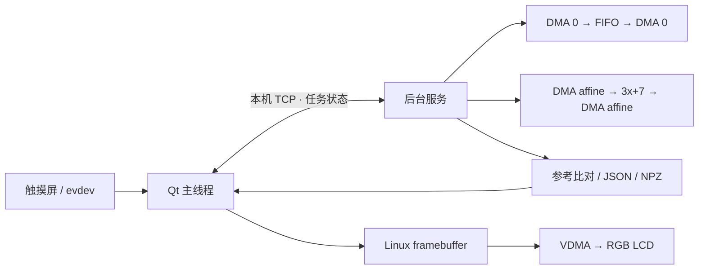

# Qt 触摸联调页

这个案例将触摸输入、Qt 界面、Linux 后台服务和真实 PL 计算接成一条可复用链路。界面提供 FIFO 回环和 `uint32` 仿射 `y = (3x + 7) mod 2^32`，支持输入长度 1–4095，显示前 8 个输入、参考与输出值、全数组比对结果及耗时。

## 文件与职责

| 文件 | 职责 |
|---|---|
| `main.cpp`、`qt_demo.pro` | Qt 5 Widgets 页面、触摸数字键盘、异步 TCP 通信、运行状态与结果显示 |
| `backend.py` | 本机任务服务，独占两路 DMA，生成输入与参考，执行 PL 调用并保存 JSON/NPZ |
| `../../tests/test_qt_backend.py` | 重复提交、参数校验、失败状态与重连查询测试 |
| [7020 板卡附录](../../references/qt-navigator7020.md) | LCD、帧缓冲、GT911、位流和启动步骤 |



## 使用流程

1. 按板卡附录加载同时包含显示与计算通路的整机位流，建立显示和触摸节点。
2. 启动后台服务，`--bit` 指向当前已加载的位流；服务使用 `download=False` 连接硬件。
3. 启动 Qt，选择通路，点击长度按钮输入元素数，点击 **Run**。
4. 运行期间禁用通路、长度和 Run；完成后显示参考比对、收到的字节数和耗时，并恢复按钮。
5. 结果写入 `--reports` 目录；Qt 重连时查询已有任务，不重复执行。

在目标 Linux 上使用已有 Qt 5 开发环境构建：

```sh
qmake qt_demo.pro
make -j2
```

在技能包根目录启动服务与界面：

```sh
sudo python3 examples/qt_demo/backend.py \
  --bit /absolute/path/to/complete_system.bit --reports reports/qt_demo
# 另一个终端；FB_NODE 和 TOUCH_NODE 由当前板卡的 sysfs 探测结果设置。
QT_QPA_PLATFORM="linuxfb:fb=$FB_NODE" \
QT_QPA_EVDEV_TOUCHSCREEN_PARAMETERS="$TOUCH_NODE" ./pynq-qt-demo
```

服务固定监听 `127.0.0.1:8766`，GUI 与服务运行在同一台板卡。GUI 退出后服务继续保存任务状态。任务结束且缓冲区未隔离时，发送 `{"op":"shutdown"}` 可以正常关闭服务；整机停止顺序见板卡附录。

## 数据与计时

请求为一行 JSON：`{"op":"run","path":"fifo","n":100}`，或 `path="affine"`。状态查询为 `{"op":"status"}`。服务返回 `task_id`、`state`、通路、长度、结果和报告路径。任务状态为 `ready → running → complete`，异常进入 `fault` 并保留原因。

- 输入使用确定性边界值与递增序列，输出采用独立 Python 参考逐元素精确比较。
- **DMA call**：发起接收/发送至完成和缓存同步的墙钟时间，沿用 `run_dma()` 的计时口径。
- **Click to result**：Qt 提交请求至收到完成状态的时间，包含 IPC、调度和状态轮询；轮询周期为 150 ms。
- 表格显示前 8 个值；PASS 基于全部 `n` 个元素。

## 验收

| 操作 | 通过条件 | 证据 |
|---|---|---|
| FIFO 与仿射各运行一次 | 两条通路分别 PASS，输出与参考相同 | JSON、NPZ、界面截图 |
| 输入 1、100、4095 | 边界和常规长度均完成 | 收到的字节数为 `4n` |
| 触摸长度按钮、数字、确认 | 数字键盘可操作，长度更新 | 人工触摸记录 |
| 运行期间重复点击 | 一次提交，完成后恢复操作 | GUI 自测与服务测试 |
| 查询/重连 | 返回同一任务状态，不再执行 | 服务测试 |
| 界面与 PL 同时运行 | Qt 事件循环保持响应，LCD VDMA 无错误 | GUI 心跳、任务报告、VDMA 状态 |

自动 GUI 检查使用 `--self-test --capture <目录>`，依次提交 FIFO 100 与仿射 4095，保存截图和 `qt_selftest.json`。这项检查使用真实服务和 PL；实体屏幕显示、触点方向及按下/释放由操作者完成验收。

## 排错经验

**后台线程提示没有 current event loop。** PYNQ 2.7 在创建 DMA 驱动时初始化 UIO 中断对象。先在服务主线程实例化两个 DMA，再由工作线程调用已有驱动进行有界轮询。`backend.py` 已采用此顺序。

**Qt 显示正常但触摸无响应。** 先检查 `/proc/bus/input/devices` 是否有 Goodix，再核对 Qt 实际打开的 event 节点；芯片探测失败时从 I²C、复位和管脚映射定位，节点存在后再检查坐标方向。

**更换位流后屏幕消失。** 完整 Overlay 包含整片 PL。使用保留 LCD/VDMA 和双计算通路的整机设计，按板卡启动顺序初始化显示。

## 换板与换算法

Qt 页面和本机任务协议可以直接复用；修改 `backend.py` 中的通路名、输入生成及参考函数来接入新算法。位流、显示初始化、帧缓冲和触摸配置集中在板卡适配层。更换数据类型或输出形状时，同步修改界面字段与输入长度约束，并按迁移验收表重新验证。
